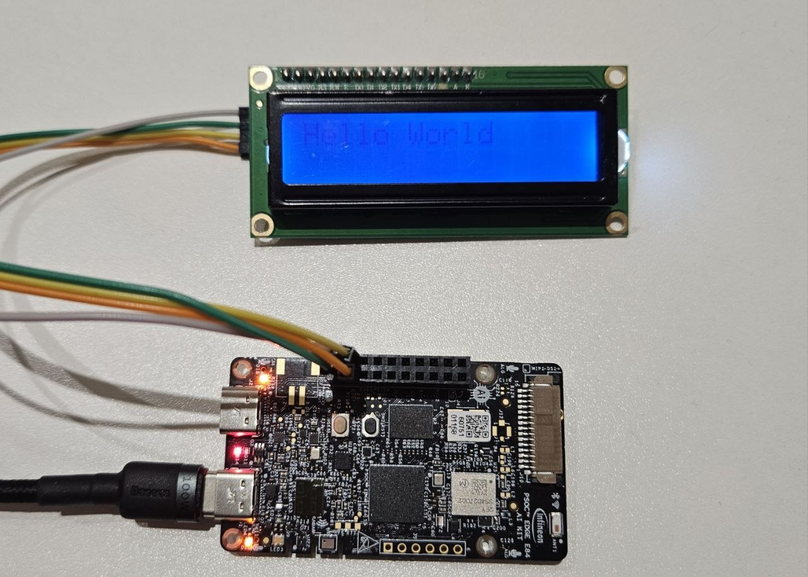
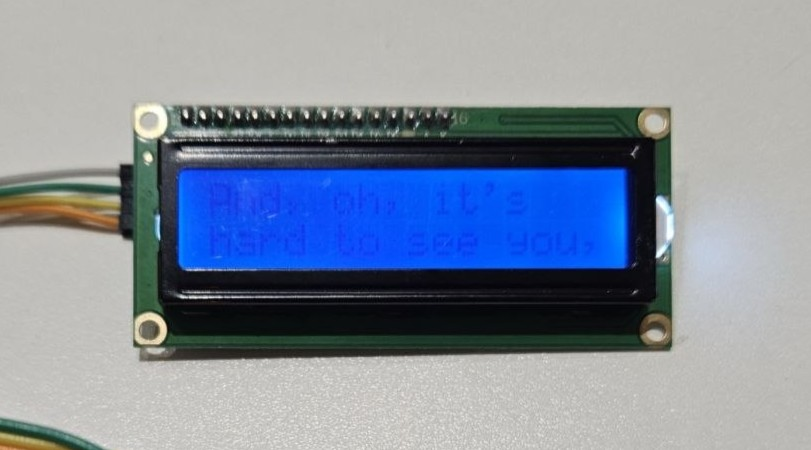
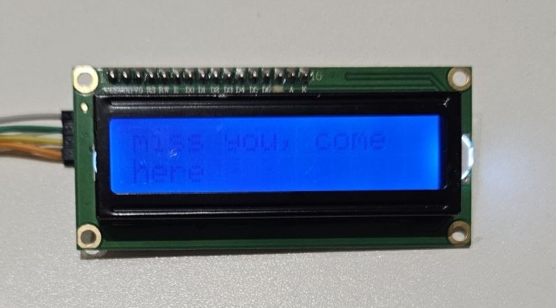

# PSOC Edge E84 LCD Lyric Display

A ModusToolbox application for the **PSOC Edge E84 AI Kit (KIT_PSE84_AI)** and a **1602 character LCD with a PCF8574T I2C backpack**. It shows `Hello World`, then displays the supplied excerpt of **Love Me Not** across the LCD's two rows.

## Display sequence

1. Initialize the LCD, enable its backlight, and show `Hello World`.
2. Keep the greeting visible for approximately **2 seconds** after the lyric task starts.
3. Show the excerpt in **12 pages**, using up to 16 characters per row. Each page lasts approximately **2.2 seconds**.
4. Leave the final phrase visible. Press the board's **Reset** button to replay.

The sequence uses adjustable delays. It does not play audio or detect the song's beat. For approximate synchronization, start the song excerpt when the first lyric appears.

## Display photos

### Hardware setup and starting phrase

The connected E84 AI Kit and 1602 LCD showing the startup greeting, `Hello World`.



### Lyric sequence

| Middle of the sequence | Ending display |
|:---:|:---:|
|  |  |

## Hardware and wiring

| LCD backpack signal | E84 connection |
|---|---|
| SCL | P17.0 / `I2C_SCL_3V3` |
| SDA | P17.1 / `I2C_SDA_3V3` |
| GND | Common ground |
| VCC | Supply required by your LCD module |

The firmware uses **SCB5** with a maximum I2C rate of **100 kHz**. The board-side SDA and SCL signals use **3.3 V logic**. If the backpack pulls these signals up to 5 V, use a bidirectional I2C level shifter. Adjust the backpack's contrast potentiometer if text is not visible.

The driver assumes this backpack mapping: P0=RS, P1=RW, P2=Enable, P3=backlight (active high), and P4..P7=LCD D4..D7. RW remains low. A module with different wiring requires driver changes.

## Build and program

1. Open `E84_I2C_LCD_Hello_World.code-workspace` in VS Code.
2. Verify your wiring and the Device Configurator settings in `bsps/TARGET_APP_KIT_PSE84_AI/config/design.modus`.
3. Run the ModusToolbox **Build** task.
4. Connect the board's **KitProg3/debug USB port** using a data cable and run **Program**.

Alternatively, from a ModusToolbox terminal in the application root:

```sh
make build
make program
```

Saving Device Configurator changes regenerates the BSP configuration; rebuild before programming. If you select a different bus, update the peripheral and clock aliases in `proj_cm33_ns/lcd_config.h`.

## Change the text and timing

Edit `proj_cm33_ns/main.c`:

- `LCD_HELLO_HOLD_MS`: greeting delay, currently `2000U` milliseconds.
- `lyric_pages[]`: text for each screen and its `hold_ms` duration, currently `2200U` milliseconds per page.

Keep each row within **16 characters** and pad shorter rows with spaces to erase previous text. Timing uses FreeRTOS tick scheduling so display-write time does not accumulate between pages.

In `proj_cm33_ns/lcd_config.h`, `LCD_I2C_ADDRESS` defaults to `0U`, which probes addresses **0x20..0x27** and requires exactly one responder. Set a known 7-bit address, such as `0x27U`, when needed. An ACK confirms an occupied address, not the identity of the device. A PCF8574A uses a different address range and needs an explicit address.

## Source layout

| File or folder | Purpose |
|---|---|
| `proj_cm33_ns/main.c` | LCD startup, lyric pages, and display task |
| `proj_cm33_ns/lcd1602.c` | PCF8574T transfers and LCD commands |
| `proj_cm33_ns/lcd1602.h` | LCD interface and result codes |
| `proj_cm33_ns/lcd_config.h` | I2C peripheral, clock aliases, and address |
| `proj_cm33_s/` | Secure CM33 startup |
| `proj_cm55/` | CM55 template application |
| `bsps/` | Board configuration |
| `docs/LCD_SETUP.md` | Additional LCD setup notes |

The application is based on Infineon's PSOC Edge Empty Application and uses its BSP, PDL, and FreeRTOS support. No additional LCD middleware is needed.
